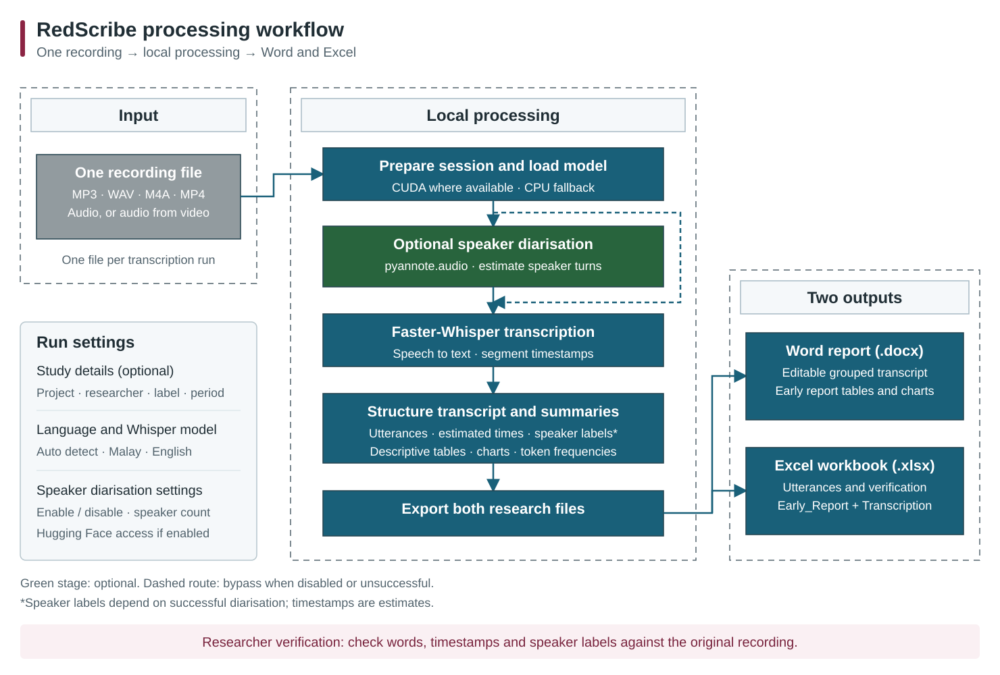
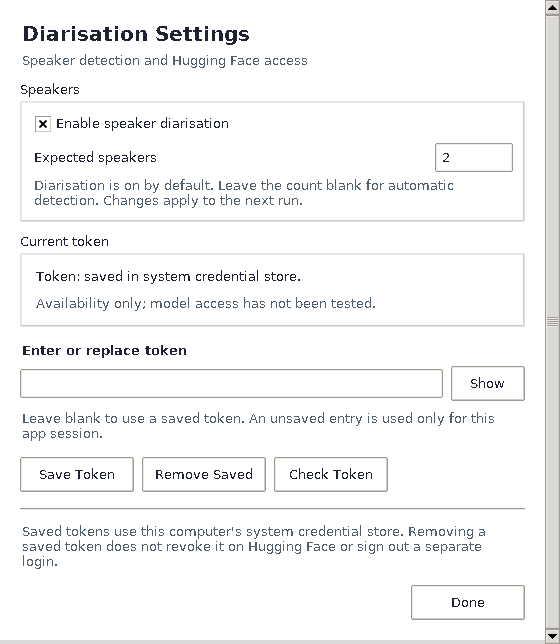

# RedScribe

[](https://doi.org/10.5281/zenodo.22941754)

RedScribe is a Windows and macOS desktop application for transcribing research interviews and other recorded speech. Version 2.0 uses Faster-Whisper by default, with optional local ASR adapters for additional models and can optionally use pyannote.audio to distinguish between speakers. It exports an Excel workbook and an editable Word report for researcher-led verification and qualitative analysis.

## Current source version

**Version 2.0.0**

No tagged GitHub Release has been published yet. The repository includes the changes listed under **Unreleased** in [CHANGELOG.md](CHANGELOG.md); the version number shown in the application has not been changed for those additions. A [RedScribe Zenodo record](https://doi.org/10.5281/zenodo.22941754) is available separately; this does not imply that a tagged GitHub Release has been archived.

The primary application is [`redscribe_gpu.py`](redscribe_gpu.py). The earlier Qwen/Ollama prototype, [`whisper_gui.py`](whisper_gui.py), is deprecated and retained only for historical reference. It is not supported or recommended for research use.

## Features

- Selectable ASR models, including optional Mesolitica, MMS, Qwen3-ASR and BuzzASR backends (see [multi-model setup](docs/MULTI_MODEL_ASR.md))
- Existing Faster-Whisper models: `large-v3` (default), `turbo`, `medium`, `small` and `base`
- NVIDIA CUDA first, with automatic CPU fallback
- Spoken-language choice: Auto detect (default), Bahasa Melayu or English; transcription does not translate the recording
- Optional speaker diarisation using `pyannote/speaker-diarization-community-1`
- Optional expected-speaker count
- Hugging Face token controls: masked entry, Show/Hide, Save Token, Remove Saved and a local Check Token button; saved tokens use the system credential store through `keyring`
- Live timestamped transcript, detected-language notice, progress and estimated remaining time
- Live diarisation activity in English, with an animated indicator, elapsed time and stage progress where pyannote reports it; a speaker timeline preview appears before transcription
- Speaker assignment and estimated sentence timestamps derived from Whisper segments
- Excel export with study metadata, an utterance-level verification worksheet, speaker counts, approximate speech/silence durations, five-minute utterance density and token frequency
- Editable Microsoft Word (`.docx`) report with the early report tables and charts, top tokens, and adjacent utterances grouped by speaker
- Numbered Excel/Word filenames on repeated runs to preserve previous reports
- Bottom controls that remain visible as the live transcript area resizes
- Red Stop button to cancel a run before report export begins

RedScribe produces an automated draft. Sentence timestamps are estimates; speech/silence figures use Whisper segment spans, and token counts are simple text frequencies rather than validated linguistic analysis. Researchers remain responsible for checking the transcript, speaker labels and analytical outputs against the original recording.

## Workflow

The following diagram summarises RedScribe's input configuration, local processing pipeline, and research-oriented outputs.



*Figure 1. RedScribe system architecture and processing workflow (input, process and output).* 

Select a recording, language and ASR model, then configure optional speaker diarisation. When enabled, diarisation runs before transcription; a diarisation failure does not prevent transcription. RedScribe subsequently prepares timestamped utterances, descriptive summaries, and Excel and Word reports for researcher verification.

During diarisation, the Live Transcript area logs the current processing stage. An animated activity line displays elapsed time even while model loading or grouping speakers provides no numerical progress. When pyannote reports completed/total work, the percentage applies only to that stage, not the whole recording or transcription run. Once diarisation finishes, RedScribe shows the speaker-label count and a preview of the first 20 speaker turns with timestamps, then begins transcription. These are automated speaker labels, not identified people; they still require researcher verification. No provisional speaker identities are displayed during segmentation or embedding extraction.

## Requirements

- Windows 10 or 11, or macOS
- Python 3.10 or 3.11 recommended
- FFmpeg available in `PATH`
- Windows: NVIDIA GPU recommended; CPU mode is supported but slower
- macOS: Apple Silicon is supported; the current version uses optimised CPU processing rather than NVIDIA CUDA
- A Hugging Face account and accepted model conditions when speaker diarisation is enabled

## Installation

### Windows 10 or 11

1. Clone the repository and enter its folder:

   ```powershell
   git clone https://github.com/saprimad/redscribe.git
   cd redscribe
   ```

2. Create and activate a virtual environment:

   ```powershell
   py -3.11 -m venv .venv
   .\.venv\Scripts\Activate.ps1
   python -m pip install --upgrade pip
   ```

3. If using an NVIDIA GPU, install the appropriate PyTorch build for the CUDA version shown by your driver. Use the command provided by the [PyTorch installation selector](https://pytorch.org/get-started/locally/).

4. Install RedScribe dependencies:

   ```powershell
   pip install -r requirements.txt
   ```

5. Install FFmpeg if it is not already available:

   ```powershell
   winget install Gyan.FFmpeg
   ```

   Close and reopen PowerShell after installation, then verify it with `ffmpeg -version`.

### macOS

RedScribe has been tested successfully on a Mac mini with an Apple M4 chip and 24 GB of unified memory. The current version runs transcription and speaker diarisation through CPU processing on Mac; NVIDIA CUDA instructions do not apply. Modern Apple Silicon can nevertheless provide strong local transcription performance.

1. Install [Homebrew](https://brew.sh/) if it is not already installed.

2. Install Git, Python 3.11 with Tkinter support, and FFmpeg:

   ```bash
   brew install git python@3.11 python-tk@3.11 ffmpeg
   ```

3. Clone the repository and enter its folder:

   ```bash
   git clone https://github.com/saprimad/redscribe.git
   cd redscribe
   ```

4. Create and activate a virtual environment:

   ```bash
   "$(brew --prefix python@3.11)/bin/python3.11" -m venv .venv
   source .venv/bin/activate
   python -m pip install --upgrade pip
   ```

5. Install RedScribe dependencies:

   ```bash
   pip install -r requirements.txt
   ```

6. Verify the installation and start RedScribe:

   ```bash
   ffmpeg -version
   python redscribe_gpu.py
   ```

The first launch may take longer while the selected Whisper model is downloaded. On a modern Apple Silicon Mac, use `large-v3` when prioritising transcription accuracy or `turbo` when prioritising faster processing. The `small` and `base` models remain useful for older Macs or systems with limited memory. If macOS asks for permission to access a folder containing the selected recording, allow access so RedScribe can read the file and save its reports.

## Speaker diarisation setup

Settings now offers **Community-1 (Recommended)** and **3.1 (Legacy / comparison)**. Community-1 remains the default, and diarisation stays on by default. The selected model is remembered separately from the ASR model and recorded in both reports. Both choices use the existing local pyannote runtime; no WSL or extra diarisation engine is added. The 3.1 option still needs a real inference/compatibility test on the current installation.

For **3.1**, also accept the conditions for [`pyannote/speaker-diarization-3.1`](https://huggingface.co/pyannote/speaker-diarization-3.1) and [`pyannote/segmentation-3.0`](https://huggingface.co/pyannote/segmentation-3.0) using the same Hugging Face account/token. Selecting a model does not download it; loading starts with a transcription run. A failed model is reported rather than silently replaced with the other choice. For Community-1, follow these steps:

1. Open the model page for [`pyannote/speaker-diarization-community-1`](https://huggingface.co/pyannote/speaker-diarization-community-1) and accept any required conditions.
2. Create a Hugging Face token with read access.
3. Start RedScribe and click **Settings** in the header or **Diarisation settings** in the Speakers panel. Paste the token into **Enter or replace token** in the Settings window. It is masked by default; **Show/Hide** toggles visibility for the typed token.
4. Click **Save Token** to remember it on this computer, then **Done** to return to transcription. The field clears after confirmed storage. Leave it blank on future launches: RedScribe retrieves its saved token automatically when diarisation starts.

**Save Token** uses `keyring` with Windows Credential Manager, macOS Keychain or a supported Linux desktop credential store (Secret Service, KWallet or libsecret). It never writes tokens to RedScribe's JSON settings or another application configuration file. Plaintext and third-party fallback backends are rejected. An operating-system prompt may ask you to unlock or allow access to the store. If the store is missing, locked or unavailable, the app shows a warning; you can still paste a token for the current session without saving it. Existing installations should run `pip install -r requirements.txt` to add the dependency.

The Speakers panel shows only a token summary (**Token saved**, **Session token**, **Token available** or **Token not configured**). Diarisation is enabled by default at each app launch. Its enable checkbox and expected-speaker count are inside Settings, and the main Speakers panel reflects those choices. Model selection stays on the main window. Token entry, Show/Hide, Save Token, Remove Saved and Check Token are inside **Settings**; closing Settings keeps any unsaved token for the current app session and reopening masks it again.

**Check Token** reports local availability and the source that will be used. It does not display the token, contact Hugging Face or validate model access. The priority is: typed session token → RedScribe's saved keyring token → `HF_TOKEN` / `HUGGINGFACE_HUB_TOKEN` environment variable → existing Hugging Face login. A saved token is not copied back into the visible entry field.

**Remove Saved** deletes only RedScribe's keyring entry. It preserves a typed session token, environment variables and any separate Hugging Face login, and does not revoke the token on Hugging Face. Check the status afterwards to see if another source is still available. Saving a new token replaces RedScribe's previous entry.

An existing Hugging Face login remains supported. If you prefer that route, run:

```powershell
python -c "from huggingface_hub import interpreter_login; interpreter_login()"
```

Enter the token at the hidden prompt and answer `n` when asked **Add token as git credential?**. This separate Hugging Face login manages its own local cache; **Remove Saved** does not delete it. There is no automatic migration of an existing login into RedScribe's keyring.

Token availability does not guarantee diarisation access: accept the model conditions and ensure the token has read access. Never commit a token, participant recording or identifiable transcript to GitHub.

## Desktop workspace


*RedScribe v2.0.0 on Windows, showing automated transcription of Podcast Ubat atau Tabu, Episode 12. Automated output requires verification against the recording. Fonts and window decorations vary by operating system.*

The workspace uses a white and maroon theme. **Study details** is a compact panel in the left column, directly below **Audio file** and above **Transcription**. It is open by default for entering the study name, researcher, audio label and reporting period, and can be collapsed afterwards. The right-hand transcript retains the full workspace height. The left column scrolls when more space is needed, while the live transcript and bottom actions remain visible.

The right panel uses larger transcript text with tighter spacing and shows English processing notices, diarisation activity and elapsed time, the speaker timeline preview, and timestamped transcription with consistent speaker colours. Consecutive segments from the same speaker append to one live paragraph, with the starting timestamp and coloured speaker label shown once inline. A speaker change starts a new paragraph. This display grouping preserves the underlying segment timestamps and existing Word and Excel exports. The bottom bar retains progress, status/ETA, **Open output folder**, **Stop** and **Start transcription**. During diarisation, percentages refer only to supported processing stages, not to completion of the entire recording.

**Settings** opens the diarisation and Hugging Face controls in a separate window. A session's settings changes apply to the next run; the current run uses the choices captured when Start was pressed. Token availability is separate from model download or model access. Settings and the left column can be scrolled on smaller screens.



## Running RedScribe

```text
python redscribe_gpu.py
```

Select an audio or video file, complete the optional study metadata, choose whether to enable speaker diarisation, and start transcription. **Transcription Language** defaults to Auto detect; select Bahasa Melayu or English when detection is inaccurate. Whisper-based choices use the transcription task rather than translation; optional backends use their own decoders. The description below ASR model explains each choice's language, precision and timestamp behaviour. A background requirements check runs before downloading models or starting diarisation; missing optional runtimes show an installation instruction. Mixed-language speech still needs checking against the recording. Matching `.xlsx` and `.docx` files are written to `output/YYYY-MM/<model>/`; both filenames also include the model name. Repeated runs create a numbered file pair rather than overwriting an earlier result. The Word file begins with the Excel `Early_Report` information and charts, followed by a transcript that combines adjacent utterances from the same speaker into one editable paragraph, labelled with the first start and last end time. The Excel workbook retains each utterance separately, along with verification columns. Speaker labels use the same colours in the live UI, Word transcript and speaker summary, and Excel Speaker cells and speaker summary. Word transcript text retains its normal colour; Excel Speaker cells have a pale matching fill. Colours are derived from the automatic label ID, not its order of appearance; UNKNOWN is grey. There are eight accent colours, so colours repeat after eight numeric IDs and do not establish a person’s identity across recordings. If a run stops with an unexpected Python error, details are written locally to `output/redscribe_error.log`; review the log before sharing it because paths may identify research files.

With Auto detect, the detected language appears in the live transcript area before the first segment. If it is wrong (for example, Welsh for a Malay recording), click **Stop**, choose Bahasa Melayu or English under Transcription Language, and start again. Stop waits for the current model-loading, diarisation or transcription step to finish; it cannot interrupt a library call instantly. A stopped run does not save a partial Word or Excel report. Once report saving begins, Stop is disabled until both exports finish. Previously completed reports are preserved.

**Whisper Model** defaults to `large-v3`. Use `small` or `base` for a CPU-only laptop, or try `turbo` for faster processing on a capable GPU; check each transcript against the audio. The selection is remembered on that computer in `%APPDATA%\RedScribe\settings.json` (or `~/.config/RedScribe/settings.json` if `APPDATA` is unavailable). This settings file contains only the model name, never a Hugging Face token or study details. The selected model and actual CPU/GPU mode are recorded in both outputs. The first use of another model downloads it from the Hugging Face Hub and needs an internet connection.

When transcription runs on CPU, RedScribe uses at most 70% of the detected logical processor count as Faster-Whisper worker threads, with a budget at least two below the total when available. This is a thread budget, **not a guaranteed 70% CPU-utilisation limit**; diarisation, other libraries and other applications have separate CPU activity. It does not prevent memory exhaustion. On a laptop, choose `small` or `base` if `large-v3` is slow or memory is limited.

Repeated runs with the same study details receive numbered filenames (for example, `_2.xlsx` and `_2.docx`) so an earlier report is preserved even while it is open.

Supported input formats shown in the interface are MP3, WAV, M4A and MP4. FFmpeg may support additional formats, but they are not currently exposed by the file picker.

## Processing and privacy

Audio transcription and diarisation run on the user's computer. Internet access may still be required initially to download model files and authenticate with Hugging Face. After the required models are cached, processing can generally occur locally.

The repository's `.gitignore` excludes common audio, video, spreadsheet, transcript, data, credential and output files. This is a safeguard, not a substitute for checking every commit before pushing research material.

## GPU acceleration and CPU fallback

The optional ASR backends require NVIDIA CUDA FP16 and never fall back silently to CPU or another precision. See [multi-model setup](docs/MULTI_MODEL_ASR.md) for installation, timing limitations and pending GPU validation.

On Windows, RedScribe attempts to load the original Faster-Whisper choices with CUDA and `float16`. If CUDA is unavailable or loading fails, it falls back to CPU with `int8`. On macOS, the current version uses CPU mode with `int8`. Speaker diarisation is sent to CUDA only when CUDA is available; otherwise it runs on CPU. A diarisation failure does not stop transcription.

## Troubleshooting

- **`ffmpeg` not found:** install FFmpeg, reopen the terminal and confirm `ffmpeg -version` works.
- **Tkinter is missing on macOS:** run `brew install python-tk@3.11`, recreate the virtual environment with the Homebrew Python 3.11 command above, and reinstall the dependencies.
- **Hugging Face access error:** accept the model conditions and check that the token has read access.
- **CUDA or DLL error:** confirm that the NVIDIA driver, PyTorch build and CUDA runtime are compatible.
- **Diarisation fails but transcription continues:** review the warning shown in the application and inspect the generated Excel metadata.
- **Slow processing:** on Windows with an NVIDIA GPU, confirm that the status bar reports `CUDA`. On Apple Silicon, try `turbo` for faster processing; reserve `small` or `base` for older Macs or systems with limited memory. CPU transcription with `large-v3` may be slower on older hardware.

## Repository files

- `redscribe_gpu.py` — current RedScribe v2 application
- `whisper_gui.py` — deprecated Qwen/Ollama prototype retained for historical reference
- `token_store.py` — system credential storage and token-source selection
- `speaker_styles.py` — shared speaker colours for the UI, Excel and Word
- `requirements.txt` — Python dependencies
- `CITATION.cff` — software citation metadata
- `CHANGELOG.md` — release history
- `LICENSE` — PolyForm Noncommercial 1.0.0 terms for the original RedScribe code and documentation

## Citation

If RedScribe supports a study, cite the software using its Zenodo DOI. The record is separate from any future tagged GitHub Release.

### APA

Tumiran, M. S., Abd Wahab, M. S., Jamal, J. A., & Othman, N. (2026). *RedScribe: Research Speech Transcription System* (Version 2.0.0) [Computer software]. Zenodo. https://doi.org/10.5281/zenodo.22941754

### IEEE

M. S. Tumiran, M. S. Abd Wahab, J. A. Jamal, and N. Othman, “RedScribe: Research Speech Transcription System,” ver. 2.0.0, Zenodo, 2026, doi: 10.5281/zenodo.22941754. [Online]. Available: https://doi.org/10.5281/zenodo.22941754

Machine-readable citation metadata are provided in [`CITATION.cff`](CITATION.cff).

## Authors

Mad Sapri bin Tumiran; Mohd Shahezwan bin Abd Wahab; Janattul Ain binti Jamal; Nursyuhadah binti Othman<br>
Malaysia copyright notification: CRDV2026W02110<br>
Faculty of Pharmacy, Universiti Teknologi MARA (UiTM), Malaysia<br>
Support: saprimad@moh.gov.my

## Licence

RedScribe's original code and documentation are available under the [PolyForm Noncommercial License 1.0.0](LICENSE). The licence permits noncommercial use, modification and redistribution under its terms. It also expressly permits use by charitable organisations, educational institutions, public research, public safety or health, environmental protection and government organisations, regardless of their funding source or obligations arising from funding. A grant alone does not trigger a fee for those organisations.

For a purpose outside the licence's permissions, contact **saprimad@moh.gov.my** to discuss a separate written paid licence before use. Sending an enquiry does not itself grant permission. PolyForm Noncommercial is a source-available licence, not an OSI-approved open-source licence. Third-party dependencies and models retain their own licence terms.
