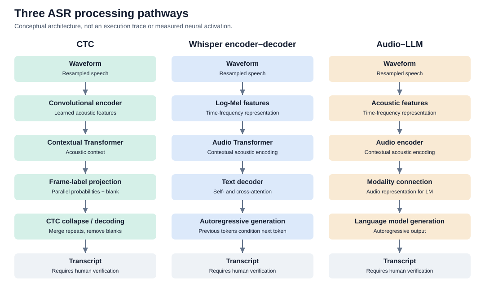
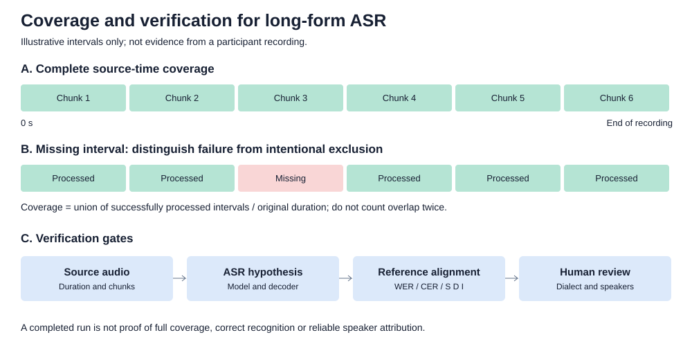

# ASR science, model architecture and benchmarking methodology

A technical guide for researchers using RedScribe. This guide describes scientific principles, documented desktop model integrations, expected limitations and the separate experimental benchmarking workflow. It is not a claim of clinical-grade, verbatim or universally accurate transcription.

## 1. From sound to text

Automatic speech recognition (ASR) estimates a linguistic sequence Y from an acoustic signal X, ideally maximising P(Y|X). Practical decoding approximates that optimum. Audio is sampled, resampled as required, represented numerically, encoded into contextual features and decoded into text.

*Figure 1. Conceptual processing pathways; not measured neural activations or a literal implementation trace.*

At 16 kHz, one second contains 16,000 samples; the Nyquist limit is 8 kHz. Short-time Fourier analysis describes changing spectral content:

$$X(m,k)=\sum_{n=0}^{N-1}x[n+mH]w[n]e^{-j2\pi kn/N}$$

Here N is window length, H is hop length and w is a window function. Power is the squared magnitude. Mel filterbanks aggregate spectral energy and logarithmic compression produces log-Mel features. Whisper large-v3 uses 128 Mel bins. Wav2Vec2 instead learns waveform features using a convolutional encoder. Frames are acoustic time units, not words.

## 2. Contextual neural representations

Transformer attention combines information across positions:

$$\operatorname{Attention}(Q,K,V)=\operatorname{softmax}(QK^T/\sqrt{d_k})V$$

Queries determine relevance to keys; values provide the information combined. Both CTC and autoregressive systems can have contextual acoustic encoders. Dense attention has a quadratic sequence-length component, so long recordings require careful segmentation. Parameter count measures learned weights, not intelligence, accuracy or actual inference latency.

## 3. Connectionist temporal classification (CTC)

Wav2Vec2 XLS-R and MMS use convolutional speech features, contextual Transformer representations and frame-level output probabilities. CTC marginalises over alignments between audio frames and the target sequence:

$$P(Y|X)=\sum_{\pi:B(\pi)=Y}\prod_t P(\pi_t|X)$$

The collapse function B merges consecutive repeated labels and removes blank symbols. For example, the illustrative path blank, a, a, blank, m, m, b, b, o becomes **ambo**. A blank between identical labels preserves a legitimate repeated character. Blank is not simply silence. Training minimises negative log likelihood of the target; forward–backward dynamic programming sums valid paths.

Greedy decoding selects the most probable label at each frame. Prefix beam search and an external language model are alternative approaches, not assumed to be enabled here. CTC factorises frame-label probabilities conditional on the input; it does not explicitly condition on previous emitted labels in the standard objective. The contextual encoder nevertheless uses surrounding acoustic information. Parallel frame scoring avoids repeated autoregressive text-decoder calls. This can make CTC fast even when the encoder is large. It does not imply intrinsically inferior accuracy.

Potential failure modes include excessive blanks, incorrect word boundaries, language adapter mismatch, acoustic ambiguity and domain shift. High deletion counts alone cannot establish which mechanism occurred.

## 4. Autoregressive recognition

Whisper encodes log-Mel features and generates text with a Transformer decoder using self-attention over prior output and cross-attention to audio features.

$$P(Y|X)=\prod_{i=1}^{L}P(y_i|y_{<i},X)$$

Training commonly uses token-level cross-entropy; inference generates tokens sequentially until a stopping criterion. Tokens may be subwords rather than words. KV caching, batching and optimised kernels reduce overhead but do not remove ordinary sequential token dependence. Linguistic priors can aid recognition of ambiguous speech or introduce plausible but unsupported text. Repetition, unwanted standardisation, early termination and hallucination are possible. Insertions are edit operations, not automatic proof of hallucination.

Audio–LLM systems such as Qwen3-ASR encode speech into representations consumed by a language-model backbone, which also generates text autoregressively.

## 5. Model profiles

The following checkpoint identifiers and desktop runtimes are taken from [the documented integrations](MULTI_MODEL_ASR.md). Nominal sizes describe model families, not measured loaded parameter totals.

| Model | Checkpoint | Architecture / nominal scale | Practical considerations |
|---|---|---|---|
| Whisper large-v3 | [openai/whisper-large-v3](https://huggingface.co/openai/whisper-large-v3) | Encoder–decoder, 1.55B; 32 encoder and 32 decoder layers | Multilingual; converted Faster-Whisper weights; substantial sequential decoding |
| Whisper large-v3 turbo | [openai/whisper-large-v3-turbo](https://huggingface.co/openai/whisper-large-v3-turbo) | Encoder–decoder, 809M; 32 encoder and 4 decoder layers | Reduced decoder depth improves speed; accuracy trade-off depends on data |
| Mesolitica Malaysian Whisper Large-v3 Turbo v3 | [checkpoint](https://huggingface.co/mesolitica/Malaysian-whisper-large-v3-turbo-v3) | Whisper-family autoregressive | Malaysian adaptation; exact loaded parameter count and revision should be recorded |
| Mesolitica XLS-R 300M Mixed | [checkpoint](https://huggingface.co/mesolitica/wav2vec2-xls-r-300m-mixed) | Wav2Vec2 CTC, nominal 300M | Fixed mixed-language decoder; greedy CTC without external LM |
| Meta MMS-1B-All — Malay | [facebook/mms-1b-all](https://huggingface.co/facebook/mms-1b-all) | Wav2Vec2 CTC, nominal 1B | Malay adapter zlm; adapter/tokenizer must match |
| Qwen3-ASR 1.7B | [checkpoint](https://huggingface.co/Qwen/Qwen3-ASR-1.7B) | Audio–LLM, nominal 1.7B designation | Official qwen-asr Transformers backend; no forced aligner in documented desktop integration |
| BuzzASR Malay | [checkpoint](https://huggingface.co/BuzzASR/malay) | Whisper large-v3 family | Malay-specific adaptation; not guaranteed dialect fidelity |

Wav2Vec2 pretraining learns speech representations from unlabelled audio through masked contextual prediction and contrastive learning with quantised targets. XLS-R extends this across languages; MMS uses multilingual representations and language-specific adapters. Whisper learns from large-scale audio/text supervision. Fine-tuning adapts pretrained weights to a target distribution but does not guarantee improved performance on a different dialect or domain. Malay language support is not equivalent to Kelantanese dialect coverage.

## 6. Long recordings and speaker diarisation

*Figure 2. Conceptual coverage and verification workflow.*

The desktop documentation specifies contiguous chunks of up to 30 seconds for additional backends, with speaker-turn boundaries when diarisation is enabled. Faster-Whisper uses its own segmentation. Chunk boundaries are not necessarily recognised word timestamps. Overlap, silence, short speaker turns, microphone quality, code-switching and dialect affect recognition. Diarisation estimates who spoke when; it neither identifies people nor guarantees correct attribution. Overlapping speech is especially difficult. Community-1 is the documented default; 3.1 is an optional comparison with separate runtime limitations. See the [desktop integration guide](MULTI_MODEL_ASR.md).

For scientific coverage auditing, compute the union of successfully processed source-time intervals divided by original duration, avoiding double-counting overlaps. Record intentional VAD exclusions separately from failures. A successful exit, output length or low RTF does not establish complete audio coverage. This is a recommended verification procedure, not a claim that every audit field already exists.

## 7. Accuracy and error behaviour

$$WER=100\frac{S+D+I}{N}$$

S, D and I are substitution, deletion and insertion counts from minimum edit-distance alignment; N is reference word count. CER uses character units. Correctly matched words H = N − S − D; hypothesis words = N − D + I. WER can exceed 100% because insertions are unbounded. WER is not semantic accuracy. Multiple optimal alignments may yield different error compositions.

Example: reference “saya pergi ke kedai”; hypothesis “saya pergi kedai” has one deletion and WER 25%. Hypothesis “saya pergi ke kedai esok” has one insertion and also WER 25%. Same WER, different behaviour. These are invented examples.

Dialect spellings, punctuation, Unicode, whitespace and filler words require a predefined scoring policy. Preserve fillers for verbatim research; report any normalised secondary analysis separately. CER can reveal partial spelling similarity but cannot substitute for human judgement. Speaker labels and timestamps should be excluded from lexical scoring unless explicitly evaluating them.

## 8. Computational efficiency

RTF = processing seconds / audio seconds; reciprocal gives times real-time speed. Distinguish inference, preparation, download, diarisation, export and end-to-end time. CUDA execution can be asynchronous: use appropriate synchronisation for timed GPU intervals. Compare actual precision, backend, batch size, chunking, warm-up and cache state; report failures rather than silently substituting devices. FP16 weights alone require about two bytes per parameter (1.55B ≈ 3.1 GB decimal), excluding activations, KV cache, buffers and context. System-wide GPU memory is not exclusive model allocation.

The documented desktop Faster-Whisper path may fall back from CUDA FP16 to CPU INT8; additional adapters require CUDA FP16. The experimental benchmark has a separate strict protocol. Model size alone cannot explain runtime because decoding architecture, implementation, sequence length and hardware utilisation differ.

## 9. Experimental benchmarking and evidence

Benchmarking remains on a separate [research branch](https://github.com/saprimad/redscribe/tree/refactor/benchmark-architecture), not the default desktop application. A user-reported seven-model single-recording Windows RTX 5070 run on 26 November 2026 produced completed statuses, worker exit codes of zero and scientific reports. See the [sanitised validation record](https://github.com/saprimad/redscribe/blob/refactor/benchmark-architecture/docs/validation/P1_SEVEN_MODEL_GPU_VALIDATION_2026-11-26.md). This is runtime evidence, not independent validation of model accuracy, full audio coverage, encryption or corpus-wide performance.

CTC models in that preliminary run showed shorter processing times and higher deletion counts than several autoregressive candidates. These observations motivate coverage and decoding audits, not a causal conclusion about architecture. Raw participant data are not reproduced here.

For a planned 25-recording × seven-model comparison, recordings are paired units; 175 observations are not 175 independent samples. Report corpus WER (sum of errors divided by sum of reference words) and recording-level macro-average separately. A Friedman test, paired post-hoc Wilcoxon tests with Holm adjustment and Kendall's W may be appropriate for complete paired data. Recording-level paired bootstrap intervals can express uncertainty; architecture comparisons are exploratory because only a few checkpoints represent each family. Document missing runs and avoid selecting models based only on a single recording.

## 10. What users should expect

| Reasonable expectation | Important limitation |
|---|---|
| Local automated draft and editable Word/Excel reports | Not certified verbatim or error-free |
| Choice of speech recognition models | Model inclusion does not guarantee accuracy or compatibility |
| Optional automatic speaker labels | Not personal identity or reliable overlapping-speech attribution |
| Approximate timestamps and descriptive summaries | Not validated word alignment or linguistic analysis |
| Local processing after necessary downloads | Not a guarantee of complete offline operation, encryption or ethical compliance |
| Performance records | Not identical to controlled scientific benchmarking |
| Experimental benchmark evidence | Not a released main-branch feature or generalised accuracy claim |

Always review the recording against the transcript before qualitative coding, quotation, publication or consequential use. Keep recordings, reference transcripts, credentials and identifying metadata private. Verify model licences separately. Hashing detects changes; locking coordinates access; encryption protects confidentiality. None implies the others.

## 11. Primary references and further reading

- Graves et al. (2006). Connectionist Temporal Classification. [ICML](https://doi.org/10.1145/1143844.1143891).
- Vaswani et al. (2017). Attention Is All You Need. [NeurIPS](https://arxiv.org/abs/1706.03762).
- Baevski et al. (2020). wav2vec 2.0. [NeurIPS](https://arxiv.org/abs/2006.11477).
- Babu et al. (2022). XLS-R: Self-supervised Cross-lingual Speech Representation Learning at Scale. [Interspeech](https://arxiv.org/abs/2111.09296).
- Radford et al. (2023). Robust Speech Recognition via Large-Scale Weak Supervision. [ICML](https://arxiv.org/abs/2212.04356).
- Pratap et al. (2024). Scaling Speech Technology to 1,000+ Languages. [Paper](https://arxiv.org/abs/2305.13516).
- [Qwen3-ASR official repository](https://github.com/QwenLM/Qwen3-ASR).
- [NIST Speech Recognition Scoring Toolkit](https://github.com/usnistgov/SCTK).
- Individual checkpoint model cards linked in Section 5.

This guide is explanatory documentation, not a peer-reviewed validation report. Diagrams are original conceptual illustrations. Exact benchmark checkpoint revisions, coverage and runtime settings require verification against run manifests and source code.
