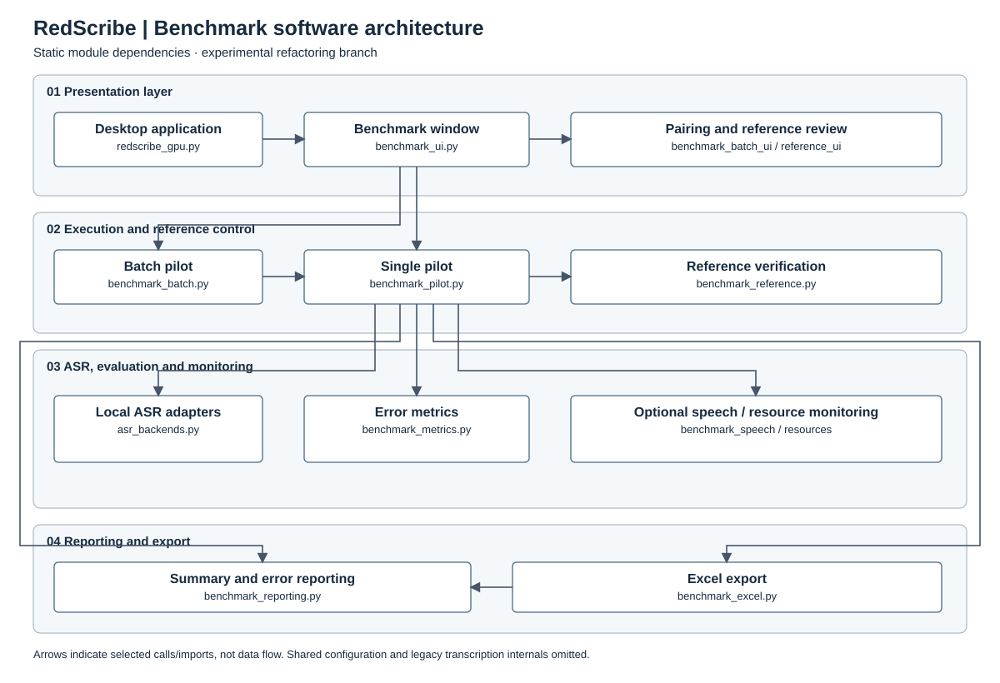

# Benchmark architecture figure

The diagram shows selected dependencies inspected in `redscribe_gpu.py`, `benchmark_ui.py`, `benchmark_batch.py`, `benchmark_pilot.py`, `asr_backends.py` and `benchmark_reporting.py`. It is not an exhaustive call graph or a runtime trace. The benchmark runner uses local ASR adapters, raw WER/CER, reference verification, optional speech/resource analysis and reporting. Batch execution invokes the single pilot. Excel export depends on reporting. Shared configuration and legacy transcription internals are omitted for readability. No scoring or study protocol changes are implied.
