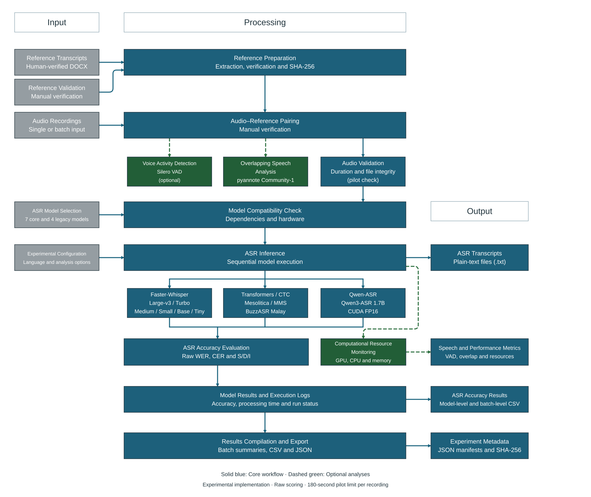

# RedScribe Benchmarking Workflow — Academic v8

The current **experimental** benchmark workflow shows how audio recordings and researcher-verified DOCX references are prepared, paired, processed across selected ASR models, and evaluated using raw WER/CER with optional speech and resource analysis.

## Latest diagram
- [Academic v8 — SVG figure](RedScribe_Benchmark_Workflow_Academic_v8.svg) — displays directly in GitHub and is suitable for scalable figures.
- [Academic v8 — interactive HTML](RedScribe_Benchmark_Workflow_Academic_v8.html) — open locally for export to SVG/PNG.

## Previous version
- [Reviewed v7 — SVG](RedScribe_Benchmark_Workflow_Reviewed_v7.svg)
- [Reviewed v7 — HTML](RedScribe_Benchmark_Workflow_Reviewed_v7.html)

**Research status:** Figure reflects code/design in the `redscribe-benchmark-timeline` experimental branch, not a completed or independently validated scientific benchmark. Normalisation, diarisation-ground-truth evaluation and other methodological HOLD items remain open. Do not commit recordings, approved transcript data, or personally identifiable material to this repository.

## Code audit and publication readiness

- [Critical static code audit — 18 November 2026](CRITICAL_CODE_AUDIT_2026-11-18.md): confirmed implementation fixes, unresolved scoring comparability risks, and priority Windows/GPU test plan.
- **Do not describe the experimental benchmarking mode as IEEE-validated yet.** Run and record full synthetic tests and real-device pilot checks first; maintain the five existing methodological HOLD decisions.

## Ground-truth preparation

- [Ground-truth preparation and verification protocol](GROUND_TRUTH_PROTOCOL.md) — DOCX extraction warnings, manual audio/span checks, frozen-reference integrity and supporting NIST/Interspeech/LREC-COLING evidence.
- UI approval now requires four manual confirmation checks and detects a DOCX change since the preview. No BM/Kelantan text normalisation policy was changed.

## WER/CER code re-review

- [Metric scoring and pipeline code review — 18 November 2026](CODE_REVIEW_METRICS_2026-11-18.md): independent short-sequence edit-distance oracle (14,641 pairs), open IEEE-readiness blockers and the next Windows validation plan.
- The source-controlled `tests/test_benchmark_metric_validation.py` adds raw-scoring regression coverage; it is **not** a substitute for external `jiwer`/SCLITE and actual runtime tests.

## Single / Batch runner audit

- [Single / Batch Runner Audit — 18 November 2026](SINGLE_BATCH_RUNNER_AUDIT_2026-11-18.md): reliability fixes, CSV/JSON status semantics, cancellation, changed-audio safeguards and remaining IEEE validation requirements.
- [Synthetic runner regression tests](../../tests/test_benchmark_runner_integrity.py) and [GitHub Actions benchmark test workflow](../../.github/workflows/benchmark-tests.yml). **CI results and RTX 5070 execution are not yet confirmed.**

## Verbatim WER/CER reporting

- [Reporting engine protocol](REPORTING_ENGINE_PROTOCOL.md) — inclusive verbatim scoring (fillers, repetitions, interviewer and all audible speakers), corpus/macro aggregation, strict common-completed cohort and data-quality safeguards.
- `benchmark_reporting.py` now exports `model_summary.csv` and `error_breakdown.csv` for single and batch studies; `benchmark_pilot.py` additionally writes separate word/character S/D/I counts.
- [Reporting unit tests](../../tests/test_benchmark_reporting.py) exercise synthetic corpus vs macro scoring, missing data, failed models and CSV output. **Runtime CI and actual Windows GPU execution have not been confirmed.**
