# Scientific architecture figures

Source baseline `d2ab724`. Arrows indicate data dependencies or control flow as described by each caption. Rounded boxes identify operations or artefacts. Decisions have a diamond outline. A dashed box marks an external research action. These diagrams describe source behaviour and the explicit human review steps.

## Architecture review

The module header in the model-major batch runner describes an experimental entry point outside the desktop UI. The matrix window imports the structured runner, which calls the private batch implementation. Figure 3 follows that executable call chain. Another easily missed route is the PDF metadata selection directly from the private state. Figures 10 and 11 show that additional filtered path. The full historical pilot workflow and older batch routes have different scheduling and scoring policies.

The SVGs are vector outputs from the adjacent Graphviz DOT sources. Rebuild an individual figure with Graphviz, for example `dot -Tsvg 01.dot -o 01.svg`.

## Figure 1. System architecture

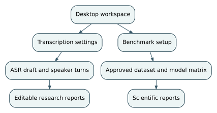

The desktop selects distinct transcription and comparative-evaluation routes. Each has its own output contract.

[Editable source](01.dot) · [redscribe_gpu.py](../../../redscribe_gpu.py) · [benchmark_matrix_ui.py](../../../redscribe/ui/benchmark_matrix_ui.py) · [benchmark_structured_output.py](../../../redscribe/benchmark/benchmark_structured_output.py)

## Figure 2. Transcription pipeline

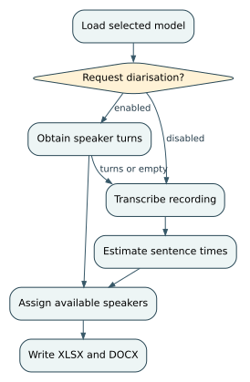

The desktop continues ASR after a diarisation failure. Local adapters may also use the available turns as chunk boundaries. The figure follows the successful export path.

[Editable source](02.dot) · [redscribe_gpu.py](../../../redscribe_gpu.py) · [asr_backends.py](../../../asr_backends.py)

## Figure 3. Structured benchmark

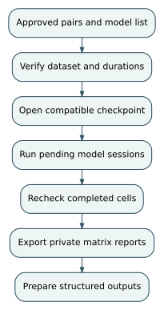

The structured runner acquires an output lock. After model-major execution it generates private products and stages the filtered reporting package.

[Editable source](03.dot) · [benchmark_structured_output.py](../../../redscribe/benchmark/benchmark_structured_output.py) · [benchmark_model_major_batch.py](../../../redscribe/benchmark/benchmark_model_major_batch.py)

## Figure 4. Reference lifecycle

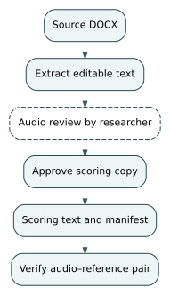

The research protocol requires listening to the recording. The software records approval and checks file identity. A digest cannot establish the correctness of the transcription.

[Editable source](04.dot) · [benchmark_ground_truth.py](../../../redscribe/benchmark/benchmark_ground_truth.py) · [benchmark_reference.py](../../../redscribe/benchmark/benchmark_reference.py) · [benchmark_dataset.py](../../../redscribe/benchmark/benchmark_dataset.py) · [GROUND_TRUTH_PROTOCOL.md](../../../docs/benchmark/GROUND_TRUTH_PROTOCOL.md)

## Figure 5. Native benchmark ASR

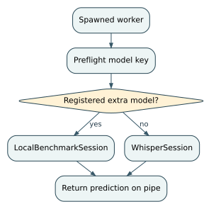

The worker selects the adapter by membership in EXTRA_MODELS. Benchmark session wrappers apply their native execution policies.

[Editable source](05.dot) · [benchmark_isolated_session.py](../../../redscribe/benchmark/benchmark_isolated_session.py) · [benchmark_local_session.py](../../../redscribe/benchmark/benchmark_local_session.py) · [benchmark_whisper_session.py](../../../redscribe/benchmark/benchmark_whisper_session.py) · [model_options.py](../../../model_options.py)

## Figure 6. Scheduling and process isolation

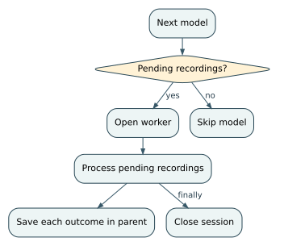

One worker can serve several recordings. An inference exception marks that cell failed and invalidates the session for subsequent pending recordings. Release also runs on cooperative stop.

[Editable source](06.dot) · [benchmark_model_major.py](../../../redscribe/benchmark/benchmark_model_major.py) · [benchmark_model_major_batch.py](../../../redscribe/benchmark/benchmark_model_major_batch.py) · [benchmark_isolated_session.py](../../../redscribe/benchmark/benchmark_isolated_session.py)

## Figure 7. Accuracy evaluation

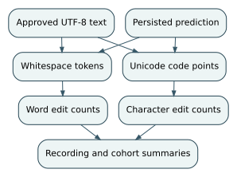

Raw word and character scores use distinct sequences and reference denominators. Summary populations depend on completion and valid counts.

[Editable source](07.dot) · [benchmark_fast_metrics.py](../../../redscribe/benchmark/benchmark_fast_metrics.py) · [benchmark_model_major_batch.py](../../../redscribe/benchmark/benchmark_model_major_batch.py) · [benchmark_matrix_reporting.py](../../../redscribe/benchmark/benchmark_matrix_reporting.py) · [benchmark_reporting.py](../../../redscribe/benchmark/benchmark_reporting.py)

## Figure 8. Checkpoint and resume

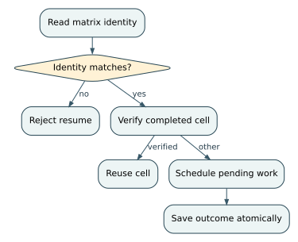

An existing checkpoint must match the complete stored identity. Reuse checks the saved prediction hash and recalculates its scores. The figure starts with a pre-existing checkpoint.

[Editable source](08.dot) · [benchmark_matrix_checkpoint.py](../../../redscribe/benchmark/benchmark_matrix_checkpoint.py) · [benchmark_model_major_batch.py](../../../redscribe/benchmark/benchmark_model_major_batch.py)

## Figure 9. Experimental provenance

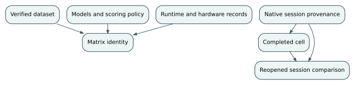

Identity fields gate checkpoint reuse. When a new native session is required, earlier completed rows supply device, precision and model provenance for comparison. Hardware provenance may be absent on injected test paths.

[Editable source](09.dot) · [benchmark_model_major_batch.py](../../../redscribe/benchmark/benchmark_model_major_batch.py) · [benchmark_provenance.py](../../../redscribe/benchmark/benchmark_provenance.py) · [benchmark_matrix_checkpoint.py](../../../redscribe/benchmark/benchmark_matrix_checkpoint.py)

## Figure 10. Structured research outputs

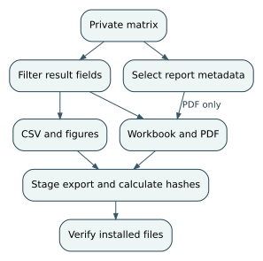

The structured export installs a PDF, workbook and supporting material. Its manifest covers listed output bytes. The original private working directory remains local.

[Editable source](10.dot) · [benchmark_structured_output.py](../../../redscribe/benchmark/benchmark_structured_output.py) · [benchmark_publication.py](../../../redscribe/benchmark/benchmark_publication.py) · [benchmark_matrix_reporting.py](../../../redscribe/benchmark/benchmark_matrix_reporting.py)

## Figure 11. Sensitive data boundary

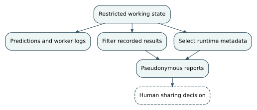

Direct identifiers are filtered by field selection and identifier handling. The proposed human sharing decision is external to the application. P-number labels may persist, so research disclosure review remains necessary.

[Editable source](11.dot) · [benchmark_structured_output.py](../../../redscribe/benchmark/benchmark_structured_output.py) · [benchmark_publication.py](../../../redscribe/benchmark/benchmark_publication.py) · [benchmark_model_major_batch.py](../../../redscribe/benchmark/benchmark_model_major_batch.py)
