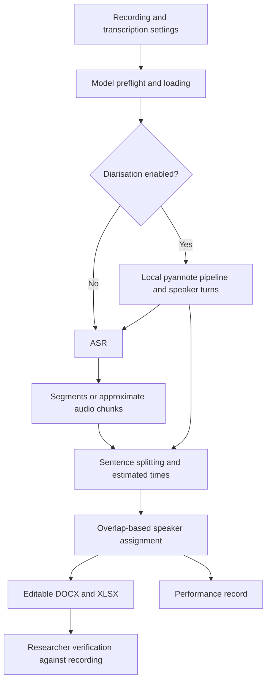

# Part I — Scientific Transcription System

**Documentation scope:** integrated development branch, 28 November 2026. The application source version remains 2.0.0; v2.1.0 is a proposed release. This document describes implementation and limitations, not a claim of validated transcription accuracy.

## 1. Scientific background

Automatic speech recognition (ASR) estimates a textual sequence from an acoustic signal. Whisper uses a sequence-to-sequence approach trained using large-scale weak supervision [1]. Multilingual and cross-lingual models, including XLS-R and MMS, provide alternative approaches to language coverage [2], [3]. These design differences do not establish accuracy for conversational Kelantan Malay. Regional vocabulary, code-switching, disfluencies, accent, overlapping speech, noise and recording conditions can affect the output.

RedScribe produces an automated draft intended to support researcher-led transcription, not replace human verification. An editable transcript is not a validated qualitative dataset merely because it was successfully exported. Human verification of wording, sequence, speaker attribution and timing remains necessary.

## 2. Architecture and operational boundary

The desktop entry point is [redscribe_gpu.py](../../../redscribe_gpu.py), with a Tkinter interface and separate workspaces guarded against simultaneous operations. The transcription route is distinct from the benchmark model-major scheduler. Both modes use shared ASR components; their inference policies differ.

*Figure I-1. Logical transcription workflow derived from the desktop entry point. The figure omits detailed error branches; it is not a measured timing diagram.*

The standard Faster-Whisper route tries CUDA FP16 first and falls back to CPU INT8 if loading fails. Optional adapters require CUDA FP16 and reject incompatible environments. The primary registry and backend routes are documented in the [model inventory](../MODELS.md). The default desktop model is Large-v3; the user's saved preference can differ.

## 3. Audio processing and decoding

The desktop file picker lists MP3, WAV, M4A and MP4. A listed extension identifies a candidate file. Successful decoding depends on its actual streams and the installed backend. The desktop passes the original file to ASR. Diarisation creates its own temporary mono 16 kHz WAV and attempts to remove the temporary directory after loading.

The main transcription call in the desktop source requests `vad_filter=True` and beam size 5 for Faster-Whisper. The local adapter accepts the same interface but does not implement that VAD flag; it decodes a 16 kHz waveform and partitions it using `chunk_ranges` with a maximum interval of 30 s, optionally splitting at diarisation boundaries. It retains gaps and avoids intentional overlapping intervals. Chunk endpoints are converted to rounded sample indices.

The Whisper-family Transformers adapter explicitly requests an encoder attention mask, invokes text-only transcription with five beams and a 440-new-token ceiling. The CTC route uses per-frame argmax and processor decoding, not an external language-model beam search. Qwen uses the qwen-asr interface with batch size one and a configured 448-new-token maximum. Actual backend defaults and revision-specific settings must be retained for exact reproduction.

These policies are not interchangeable. Standard transcription is not the raw-v1-cuda-fp16 benchmark policy. In particular, diarisation boundaries, VAD and CPU fallback can change results.

### Timing and segmentation

Faster-Whisper returns model segments; RedScribe distributes estimated sentence times within those segments by splitting after configured terminal punctuation followed by whitespace and allocating segment duration in proportion to sentence character counts. Optional adapters report approximate chunk/turn boundaries, not forced-aligned word times. Speaker attribution uses interval overlap rather than a verified word-level alignment. Do not interpret these timings as independently measured lexical onset and offset.

## 4. Speaker diarisation

Diarisation partitions a recording into labelled speaker intervals (who spoke when), whereas identification associates a voice with a known individual. RedScribe supports the local pyannote Community-1 and legacy 3.1 pipelines [4], [5]. Pipeline access may require acceptance of model terms and authentication. The program can optionally request a positive expected speaker count. The input is converted via FFmpeg to mono 16 kHz audio, read by SoundFile, and passed as a tensor; this bypasses a problematic built-in audio decoder path observed in some Windows configurations.

The program prefers exclusive speaker diarisation when available, then the standard speaker annotation. It sorts returned intervals. The speaker assignment function chooses the turn with greatest temporal overlap, then tests the segment midpoint if necessary; unmatched segments receive UNKNOWN. Exclusive diarisation does not represent the full overlapping-speaker timeline. Approximate time assignment, interruptions and simultaneous speech can produce speaker attribution errors.

No speaker-identity verification, diarisation error rate (DER), Jaccard error rate (JER) or speaker-specific WER validation is established for the current research dataset. Speaker-labelled DOCX without reference timestamps does not support DER/JER evaluation. Neither successful loading nor a vendor benchmark establishes performance on this dataset.

## 5. Research outputs

| Artefact | Implementation and meaning |
| --- | --- |
| DOCX | Editable research report, metadata, descriptive summaries, speaker-labelled grouped transcript and estimated times. |
| XLSX | Early_Report metadata and descriptive summaries, and a Transcription sheet with utterance number, speaker, start, end, automated text, researcher verification/correction and notes. |
| Performance log | Stage timings and software/runtime metadata through performance_log.py. |
| Descriptive summaries | Utterance counts, speaker counts, basic token/keyword counts, timeline density and segment-derived speech/silence where applicable. |

The summaries describe model output, not necessarily actual speech activity. Segment-derived speech/silence is not an independent VAD measurement; for chunk-based output, speech and silence are explicitly reported as not measured. Frequency counts are not validated themes, topic models or qualitative coding. These files may contain participant text and research metadata and must remain in authorised storage.

Stop is cooperative during processing. The desktop checks a stop event at processing boundaries and during segment iteration. Saving begins under the run lock and disables Stop. A Word export error after a successful Excel export yields a partial outcome. When optional diarisation fails, the application issues a warning and can continue transcription with unknown speakers. Review the completion message, performance record and each expected output before accepting a run.

## 6. Validation and appropriate use

The current P1 seven-model evidence belongs to **Benchmarking Mode**, not an accuracy validation of the standard transcription/diarisation route. Standard transcription uses shared components but has a different operational policy. Historical development records, [ASR setup](../../MULTI_MODEL_ASR.md) and the [consolidated validation record](../../validation/CONSOLIDATED_DEVELOPMENT_RECORD_2026-11-28.md) provide context. A separate standard-mode regression run is recommended before release: verify launch, both available modes, output schemas, cancellation, known failure handling, CPU fallback and supported optional diarisation configurations using non-sensitive audio. Platform-specific success must be documented rather than extrapolated.

Suitable use: creating draft research transcripts and editable supporting files, subject to review. Unsuitable inference: claiming that an exported document is verbatim, correctly attributed, analytically coded or scientifically accurate without further evidence.

## References

[1] A. Radford et al., “Robust Speech Recognition via Large-Scale Weak Supervision,” *Proc. ICML*, PMLR, vol. 202, pp. 28492–28518, 2023. https://proceedings.mlr.press/v202/radford23a.html

[2] A. Babu et al., “XLS-R: Self-supervised Cross-lingual Speech Representation Learning at Scale,” *Proc. Interspeech*, 2022. https://doi.org/10.21437/Interspeech.2022-143

[3] V. Pratap et al., “Scaling Speech Technology to 1,000+ Languages,” arXiv:2305.13516, 2023 (preprint). https://arxiv.org/abs/2305.13516

[4] pyannote, “Speaker diarization community-1,” model card. https://huggingface.co/pyannote/speaker-diarization-community-1

[5] pyannote, “Speaker diarization 3.1,” model card. https://huggingface.co/pyannote/speaker-diarization-3.1

See the [citation verification register](../REFERENCES.md) for the scope of source verification.
