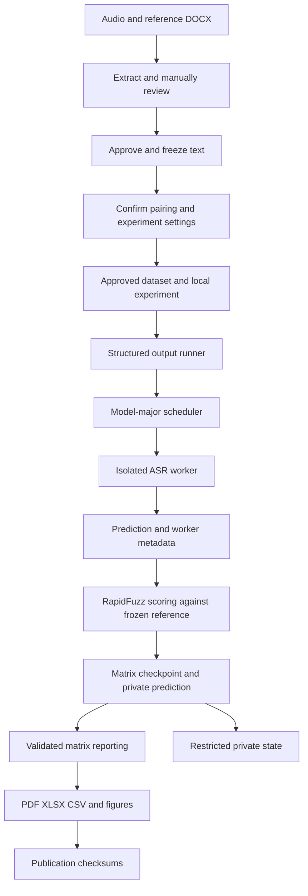
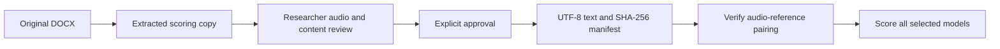
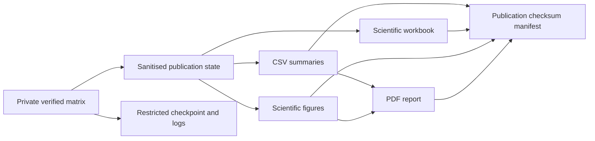

# Part II — Scientific Benchmarking System

**Scope:** model-major structured benchmarking on the integrated development branch. Feature freeze; proposed release v2.1.0. This document is a technical and methodological description, not certification of a completed comparative study.

## 1. Scientific rationale and estimand

RedScribe compares the output of selected ASR pipelines against a common researcher-approved reference for each recording. The objective is to characterise transcription error and operational computational efficiency under documented conditions. It does not isolate the causal effect of neural model architecture: decoding, training data, chunking, backend, checkpoint, output conventions and resource use differ.

The recording is the experimental block. The primary target is whole-recording speech-only verbatim recognition, including both interlocutors. No speaker-level ground truth alignment or speaker-specific recognition performance is implied.

## 2. Architecture

*Figure II-1. Current logical structured workflow. Resume verifies checkpoint identity and stored predictions before reusing results. The figure does not claim that every runtime gate has been independently tested.*

The visible workspace supports single-recording setup. Internal model-major code supports multiple approved pairs, loading a session once per model and processing pending recordings sequentially. Older single/pilot and batch routes are retained, but are not the same execution/scoring pipeline. The model-major worker is a spawned subprocess; the parent persists scientific state, while the child transcribes through a dedicated pipe.

| Layer | Source |
| --- | --- |
| Desktop integration and setup | [redscribe_gpu.py](../../../redscribe_gpu.py), [benchmark_ui.py](../../../redscribe/ui/benchmark_ui.py) |
| Reference and dataset | [benchmark_ground_truth.py](../../../redscribe/benchmark/benchmark_ground_truth.py), [benchmark_reference.py](../../../redscribe/benchmark/benchmark_reference.py), [benchmark_dataset.py](../../../redscribe/benchmark/benchmark_dataset.py) |
| Experiments and live runner | [benchmark_experiments.py](../../../redscribe/benchmark/benchmark_experiments.py), [benchmark_matrix_ui.py](../../../redscribe/ui/benchmark_matrix_ui.py) |
| Scheduler and execution | [benchmark_model_major_batch.py](../../../redscribe/benchmark/benchmark_model_major_batch.py), [benchmark_model_major.py](../../../redscribe/benchmark/benchmark_model_major.py), [benchmark_isolated_session.py](../../../redscribe/benchmark/benchmark_isolated_session.py) |
| Scoring | [benchmark_fast_metrics.py](../../../redscribe/benchmark/benchmark_fast_metrics.py), [benchmark_metrics.py](../../../redscribe/benchmark/benchmark_metrics.py) |
| Persistence | [benchmark_matrix_checkpoint.py](../../../redscribe/benchmark/benchmark_matrix_checkpoint.py) |
| Reporting | [benchmark_matrix_reporting.py](../../../redscribe/benchmark/benchmark_matrix_reporting.py), [benchmark_publication.py](../../../redscribe/benchmark/benchmark_publication.py), [benchmark_structured_output.py](../../../redscribe/benchmark/benchmark_structured_output.py) |

## 3. Reference lifecycle

The [canonical Ground Truth Protocol](../../benchmark/GROUND_TRUTH_PROTOCOL.md) governs preparation. Keep original qualitative transcripts unchanged, create a separate speech-only verbatim reference, verify audio span and preserve dialect, fillers, repetitions and code-switching. Remove verified non-spoken labels and annotations only. Unresolved audible words require independent review, not invention or silent omission. Use a fixed reference for every model; any justified change requires a new version and a new comparable experiment.

*Figure II-2. Reference approval lifecycle. A checksum confirms byte integrity, not semantic correctness or audio coverage.*

The UI requires manual review checks. At the lower-level API, `approve_reference` requires acknowledgement but accepts an optional verification dictionary; therefore do not claim that every programmatic call necessarily includes all four checks. The protocol is mandatory for official research regardless of the invocation route.

## 4. Experimental conditions and scoring

Eleven model options, seven default; see [model inventory](../MODEL_INVENTORY.md). Model-major policy requests CUDA FP16, rejects incompatible device/precision, checks the decoded source duration (positive and at most 7,200 s), verifies input identity, and records model provenance. Identical source bytes and references do not imply identical acoustic windows or decoding strategies. Standard Faster-Whisper model-major decoding explicitly sets task transcribe, beam size 5, VAD off and previous-text conditioning on. Local adapters decode to 16 kHz and partition into intervals of at most 30 s without intentional overlap, with backend-specific decoding and token ceilings.

See [Benchmark Methodology](../BENCHMARK_METHODOLOGY.md) for metric definitions, alignment, aggregation, timing and resource measurement; see [Statistical Analysis Protocol](../STATISTICAL_ANALYSIS_PROTOCOL.md) for proposed inferential analyses. No inferential statistical tests are claimed to be implemented by the scientific report generator.

## 5. Experiment management and reproducibility

The approved dataset manifest confirms unique recording identifiers and unique audio/source DOCX content, records source/reference hashes and is re-verified before use. The experiment manager creates local output directories and stores approved configurations. Matrix identity binds dataset, selected models, scoring-engine version, requested configuration and recorded runtime provenance. Resume verifies saved prediction hash and recalculates scores; changed identity is rejected. Previously completed cells may be reused without reloading models if all cells for a model are valid. When pending cells require a new session, its recorded model provenance is compared with existing completed observations. This is not a cryptographic guarantee of every model weight or a fresh rerun.

A failed inference invalidates the current session; later pending recordings in that session are marked not_run. Failed or unscored observations must not receive artificial 0% or 100% WER. Stop is cooperative at scheduler boundaries; do not assume immediate interruption of a blocked native call. The Windows Large-v3 workaround unloads native weights and exits the disposable worker before the wrapper destructor, rather than demonstrating that the upstream destructor defect is fixed.

## 6. Scientific reporting

*Figure II-3. Logical publication boundary. Folder separation and pseudonymisation do not provide encryption or anonymity.*

The workbook contains Model summary, Recording results and Efficiency. Accuracy and efficiency exports retain valid denominators, counts and unavailable observations. Figures include corpus accuracy, recording WER heatmap, WER/CER distributions and an accuracy–speed plot. Distribution graphics are generated even for a single common recording but are not informative about variability in that case. The report supports descriptive interpretation only; consult underlying counts and common-cohort membership before comparing models.

See the [illustrated guide](../../user-guide/README.md) for workflow screenshots and sample exports. These are actual single-recording outputs and may only be distributed consistently with research permissions. Source audio, raw speech, checkpoints and logs are restricted. Publication manifests cover output bytes, not confidentiality, completeness or scientific validity.

## 7. Validation and open gates

The [consolidated development record](../../validation/CONSOLIDATED_DEVELOPMENT_RECORD_2026-11-28.md) reports the full-length P1 run with all seven model observations completed. The [numerical revalidation record](../NUMERICAL_REVALIDATION.md) separately checks accessible evidence. P1 results are preliminary and not general model rankings. Higher WER may reflect formatting, linguistic mismatch, inference constraints or incomplete recognition; edit totals alone cannot attribute causation.

The [release and outstanding validation gates](../RELEASE_READINESS.md) distinguish documentation completion, software readiness and research readiness. No official release or human peer review is asserted.
