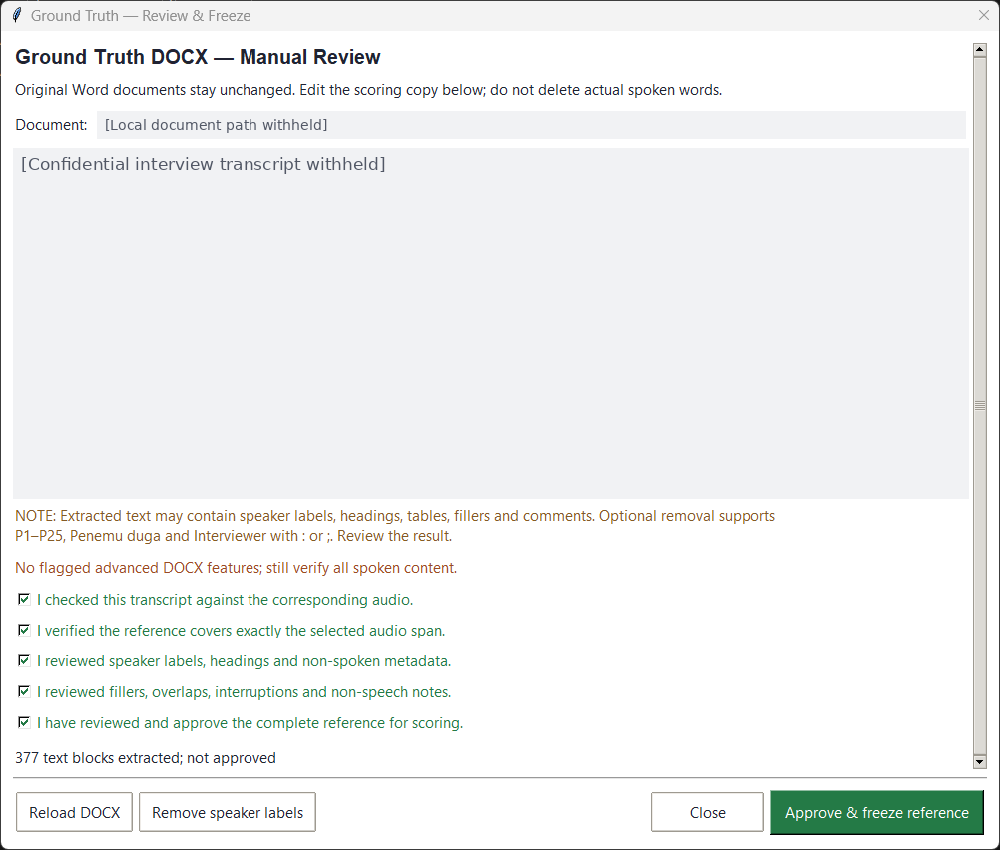
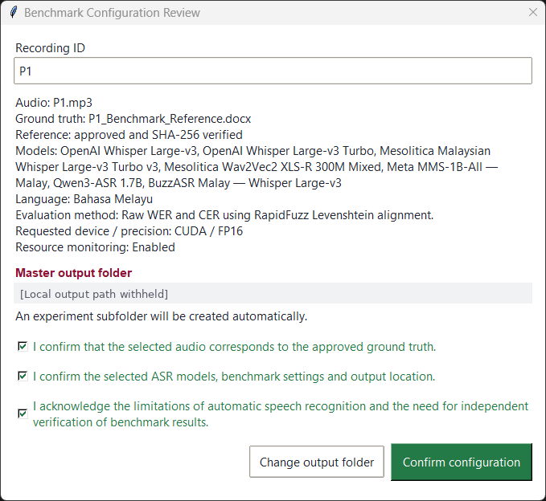
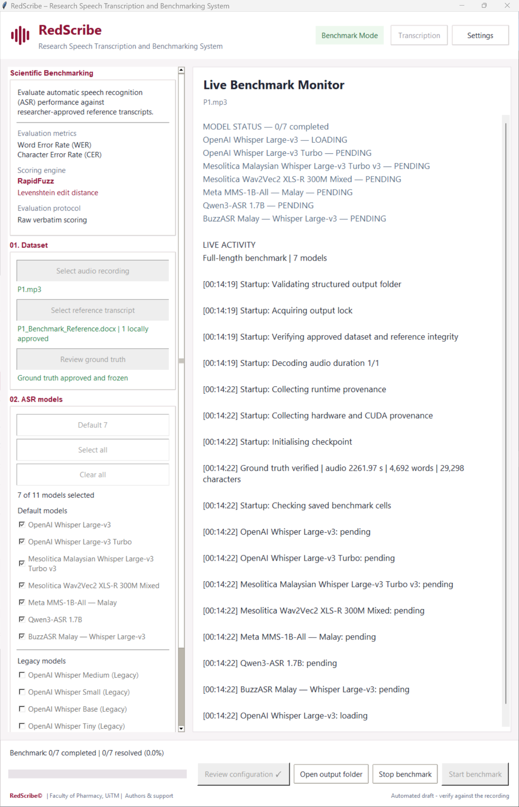
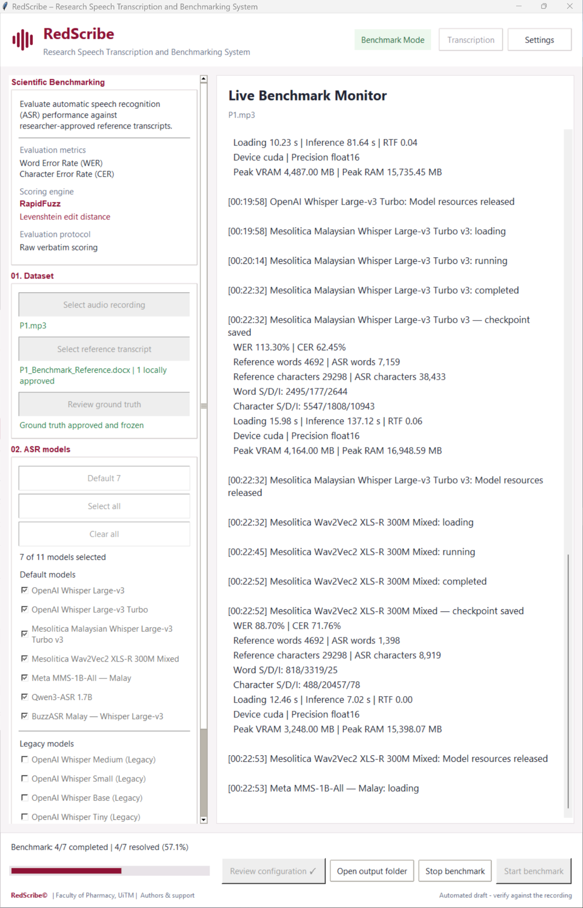
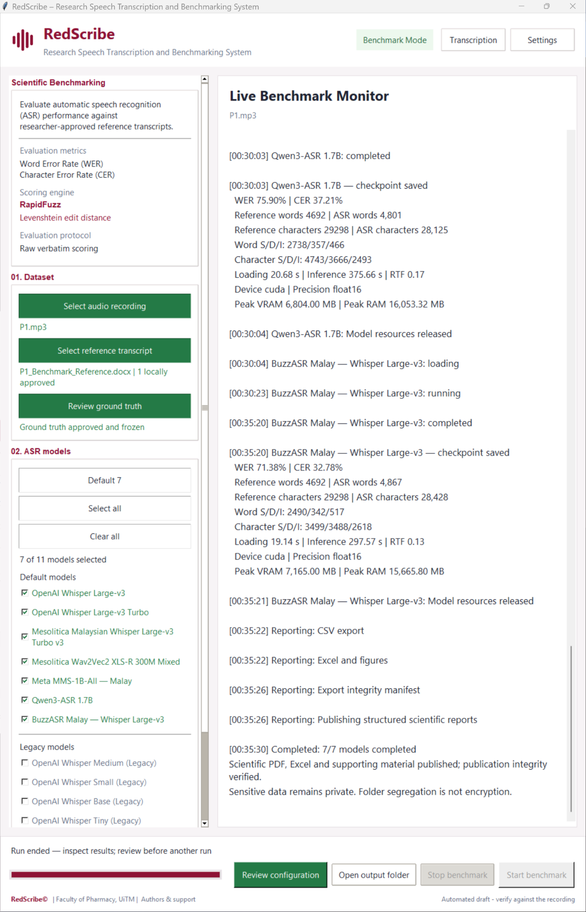
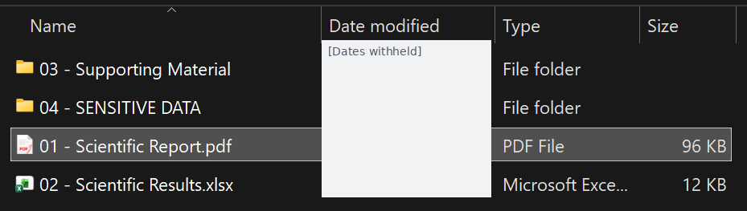

# RedScribe — User Guide and Demonstration

**Research Speech Transcription and Benchmarking System**

**Documentation snapshot:** 28 November 2026 | Benchmarking workflow demonstrated on Windows | Runtime commit `df8d6a3`

RedScribe combines conventional transcription with a separate scientific benchmarking workspace. This guide documents the actual single-recording workflow used during the seven-model P1 validation run. It does not replace the [Ground Truth Preparation and Verification Protocol](../benchmark/GROUND_TRUTH_PROTOCOL.md) or the [Consolidated Development and Validation Record](../validation/CONSOLIDATED_DEVELOPMENT_RECORD_2026-11-28.md).

## Before starting

Prepare a recording and a matching speech-only full verbatim DOCX. Install the required model dependencies, select Benchmark mode, and keep all source and private output files in authorised local storage. The visible workflow evaluates one recording at a time.

## 1. Ground Truth Review

Select the audio and matched DOCX. Review the separate scoring copy against the complete audio. Remove only verified non-spoken labels and annotations; preserve dialect, fillers and repetitions. Complete all four verification checks and the approval acknowledgement, then select **Approve & freeze reference**. The original document is unchanged. The screenshot has its transcript and local path deliberately obscured.

*Figure 1. Ground Truth Review — actual validation interface, with confidential fields obscured where necessary.*

## 2. Configuration Review

Select the models, language and resource monitoring. Review the recording ID, audio, approved reference, requested CUDA/FP16 settings and output location. Complete the three confirmation checks, then select **Confirm configuration**. The local folder path has been obscured.

*Figure 2. Configuration Review — actual validation interface, with confidential fields obscured where necessary.*

## 3. Benchmark initialisation

Select **Start benchmark**. RedScribe validates the output directory, locks the experiment, verifies the approved dataset, records runtime provenance and initialises the checkpoint. The live monitor shows pending/loading statuses.

*Figure 3. Benchmark initialisation — actual validation interface, with confidential fields obscured where necessary.*

## 4. Live benchmark monitoring

Models run sequentially. The live monitor displays WER/CER, edit counts, reference and ASR lengths, inference and loading times, RTF, device, precision and sampled resource peaks. Configuration is locked while running. Stop is available. A completed worker does not itself prove complete audio coverage.

*Figure 4. Live benchmark monitoring — actual validation interface, with confidential fields obscured where necessary.*

## 5. Completion and reporting

The completed run displays 7/7 models and publication status. RedScribe exports CSV data, Excel results, figures and a scientific report. Inspect the results before starting another run.

*Figure 5. Completion and reporting — actual validation interface, with confidential fields obscured where necessary.*

## 6. Structured output

Select **Open output folder** to inspect the four principal outputs. The file-list screenshot is cropped and dates are obscured to avoid revealing workstation navigation or exact run timestamps.

*Figure 6. Structured output — actual validation interface, with confidential fields obscured where necessary.*

## 7. Scientific output

| Output | Purpose |
| --- | --- |
| `01 - Scientific Report.pdf` | Executive summary, recognition metrics, error profiles, efficiency and scientific figures. |
| `02 - Scientific Results.xlsx` | Numerical model summary, recording results and efficiency data. |
| `03 - Supporting Material/` | Figures, statistical tables and publication integrity manifest. |
| `04 - SENSITIVE DATA/` | Restricted checkpoint, predictions, source/reference metadata and diagnostic logs. Never distribute as a sample. |

- [Sample scientific report (PDF)](sample-outputs/Sample%20Scientific%20Report.pdf)
- [Sample scientific results (Excel)](sample-outputs/Sample%20Scientific%20Results.xlsx)
- [Sample provenance and checksums](sample-outputs/README.md)

## 8. Research interpretation and confidentiality

WER and CER are raw edit-distance measures, not semantic accuracy measures. RTF excludes loading. System-wide resource peaks are not model-exclusive allocations. The sample represents one recording only. Actual audio coverage and repeatability remain separate validation requirements.

Screenshots and outputs retain pseudonymous recording code P1 and actual numerical results. The transcript pane and private directory paths have been obscured in the screenshot copies. Keep original evidence privately. Review research permissions before public distribution, because pseudonymisation is not anonymisation. The package does not include any audio, raw transcript, private checkpoints, original screenshots containing speech, or logs.
