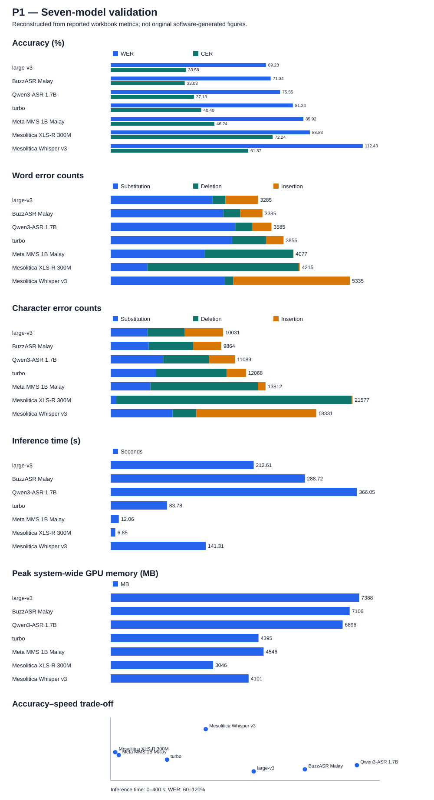

# Seven-model full-length GPU runtime validation — 26 November 2026

## Scope
One recording (P1), 2,261.969 s; 4,745 reference words and 29,868 reference characters. Tested checkout reported as `2d21ddd` on `refactor/benchmark-architecture` (terminal evidence; not independently bound to workbook). Windows, RTX 5070 12 GB, Python 3.11.9, PyTorch 2.10.0+cu130, driver 610.88, CUDA/FP16. Standalone FP16 computation returned finite output and exit code 0.

All seven models were marked completed in the UI and workbook; all worker exit codes were 0 and cleanup completed. Large-v3 used controlled process exit; others normal destructor. Total inference time 1111.38 s.

| Model | WER (%) | CER (%) | Word S | Word D | Word I | Char S | Char D | Char I | Inference (s) | RTF | GPU MB |
|---|---:|---:|---:|---:|---:|---:|---:|---:|---:|---:|---:|
| large-v3 |69.23|33.58|2267|292|726|3276|3303|3452|212.61|0.0940|7388|
| BuzzASR Malay |71.34|33.03|2511|376|498|3396|3954|2514|288.72|0.1276|7106|
| Qwen3-ASR 1.7B |75.55|37.13|2779|375|431|4690|4071|2328|366.05|0.1618|6896|
| turbo |81.24|40.40|2709|754|392|4056|6297|1715|83.78|0.0370|4395|
| Meta MMS 1B Malay |85.92|46.24|2099|1966|12|3542|9585|685|12.06|0.0053|4546|
| Mesolitica XLS-R 300M |88.83|72.24|818|3372|25|474|21026|77|6.85|0.0030|3046|
| Mesolitica Whisper v3 |112.43|61.37|2547|187|2601|5514|2126|10691|141.31|0.0625|4101|

WER/CER/RTF arithmetic reported consistent in local documentation; this is not independent alignment or audio coverage validation. GPU memory is system-wide.

## Reconstructed accuracy figure

## Evidence of output generation
The original local folder screenshot showed scientific_results.xlsx, recording_results.csv, model_summary.csv, efficiency_summary.csv, matrix.json, export_integrity.json, approved_dataset.json, .benchmark.lock, worker logs and PNG/SVG figures for accuracy-speed, corpus accuracy, WER/CER distributions and participant WER heatmap. The original generated figures and integrity records have not been independently inspected. The local redacted HTML and ZIP evidence archive are retained separately; raw workbook and screenshots are not published here for privacy.

## Release boundary
Single-recording runtime success only. UI ended with a generic inspect-failures-and-reports message; workbook reported no failed models. Verify worker logs, export integrity, dataset freeze/encryption, original figures, full audio coverage (especially MMS and XLS-R), and multi-participant execution before full experiment. No model superiority inference from n=1.

Preserve this baseline. Output organisation and further features are a separate design discussion; no implementation changes in this documentation update.
